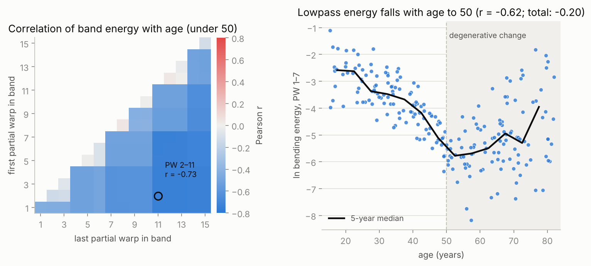

# partial-warp-bandpass

**Bandpass filtering of thin-plate spline bending energy: find the geometric scale at which a
surface's shape tracks a variable such as age.**

[](https://github.com/gbravomorante/partial-warp-bandpass/actions/workflows/tests.yml)


[](https://doi.org/10.1007/s00414-021-02555-6)

This is a clean, tested implementation of the method from my doctoral work on the human pubic
symphysis ([Bravo Morante et al. 2021, *International Journal of Legal Medicine*](https://doi.org/10.1007/s00414-021-02555-6)).
The question behind it: forensic age estimation from the pubis relies on the articular surface
looking "rougher" or "smoother", but which part of that roughness actually changes with age?

The answer turned out to be **scale**. Decomposing each surface's deformation into partial
warps, from the broadest bend to the finest ripple, and summing the bending energy over a band
of them, gave a correlation with age that **peaked sharply for the first seven partial warps**
(r = −0.648 on 188 right-side surfaces under 50, from a sample of 440 scans). The age signal is a
flattening at large scales, not reduced roughness as such; the fine scales mostly add noise.



*Simulated surfaces with a known answer (`examples/synthetic_age_signal.py`). Left: correlation
with age for every band within partial warps 1–15. Right: the lowpass band PW 1–7 falls with age
until 50 (r = −0.62), while total bending energy barely does (r = −0.20).*

## What it does

| Step | Function |
|---|---|
| Align surfaces (generalized Procrustes, kept in original units) | `gpa` |
| Bending-energy matrix of the mean surface's best-fitting plane | `bending_energy_matrix` |
| Partial warps, ordered from largest to smallest scale | `partial_warps` |
| Each specimen's amplitude on each partial warp (deformation perpendicular to the plane) | `partial_warp_amplitudes` |
| Bending energy within a band, Σ λⱼ aⱼ² for j in [first, last] | `band_energy` |
| Correlation with a target for every band, and the best one | `band_correlations`, `best_band` |

Only NumPy is required. For semilandmark sliding, missing landmarks and quality control before
this step, see [gmm-core](https://github.com/gbravomorante/gmm-core).

## Quick start

```bash
pip install "partial-warp-bandpass @ git+https://github.com/gbravomorante/partial-warp-bandpass"
```

```python
import numpy as np
from pwbandpass import gpa, partial_warps, partial_warp_amplitudes, band_correlations, best_band, band_energy

shapes, d2 = gpa(landmarks)            # (n, k, 3) fixed landmarks + surface semilandmarks
keep = d2 < 0.05                       # outlier cut used in the paper
shapes, age = shapes[keep], age[keep]

reference = shapes.mean(axis=0)
warps = partial_warps(reference)
amplitudes = partial_warp_amplitudes(shapes, warps, reference)

young = age < 50
r = band_correlations(amplitudes[young], warps, age[young], max_warp=15)
first, last, r_best = best_band(r)     # e.g. (1, 7, -0.65)
energy = band_energy(amplitudes, warps, first, last)
```

To reproduce the figure:

```bash
pip install -e ".[examples]"
python examples/synthetic_age_signal.py
```

## Tests

```bash
pip install -e ".[dev]"
pytest
```

The tests check the mathematics rather than snapshots: the bending-energy matrix is symmetric
and positive semi-definite with exactly the affine functions in its null space; partial warps
are orthonormal, ordered, and unaffected by position and orientation; the bands partition the
total energy; a deformation built from one partial warp appears only in its own band; and the
lowpass band recovers a simulated age signal that the total energy misses.

## A note on use

This is a research method, not a forensic age calculator. A correlation of −0.65 means age
explains under half of the variance in the filtered energy, and the signal disappears after 50.
Fred Bookstein and I discuss what morphometric quantifications of the pubis can and cannot
deliver for individual age estimates in
*The fallacy of forensic age estimation from morphometric quantifications of the pubic symphysis*
(in *Remodeling Forensic Skeletal Age*, Elsevier, 2021). The method is general: any variable,
any surface patch with a stable semilandmark template.

The landmark data of the original study are published on
[OSF](https://osf.io/867md/) and are not redistributed here.

## Related work

- Bravo Morante G, Bookstein FL, Fischer B, Schaefer K, Alemán Aguilera I, Botella López MC (2021).
  Correlation of the human pubic symphysis surface with age-at-death: a novel quantitative method
  based on a bandpass filter. *International Journal of Legal Medicine* 135, 1935–1944.
  [doi:10.1007/s00414-021-02555-6](https://doi.org/10.1007/s00414-021-02555-6)
- Bravo Morante G, Fischer B, Botella López MC, Bastir M (2021). The outline of the pubic symphyseal
  surface is sexually dimorphic and changes with age in humans. *Journal of Anthropological
  Sciences* 99, 83–95. [doi:10.4436/JASS.99003](https://doi.org/10.4436/JASS.99003)

## License

MIT. If you use the method, please cite the paper (see `CITATION.cff`).
